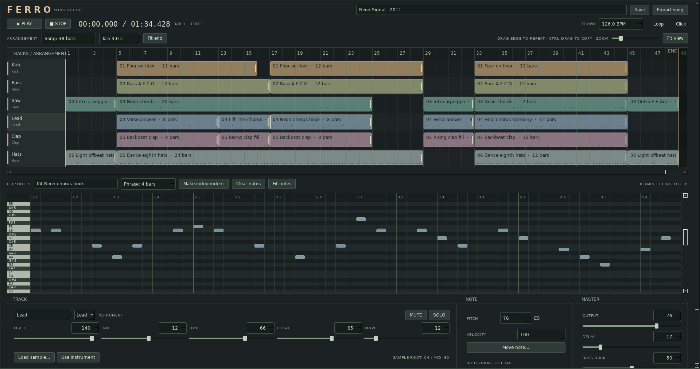

# FERRO

## 먼저 알아둘 하단 조절값

화면 하단의 값을 바꾸면 무엇이 달라지는지부터 확인하세요. **TRACK은 선택한 트랙의 악기와 소리 기본값**, **NOTE와 NOTE SOUND는 선택한 음 하나**, **MASTER는 곡 전체**에 관한 설정입니다. NOTE SOUND에서 따로 지정하지 않은 소리 항목은 TRACK 값을 따릅니다.

기존 음의 높이·세기·음색을 바꾸려면 **Shift + 왼쪽 클릭으로 선택**합니다. 일반 왼쪽 클릭은 빈 곳에 음을 추가하고, 이미 소리 나는 음이 있는 곳에서는 삭제 확인창을 엽니다. 타격 시점만 바꾸려면 선택 후 **Move note…**를 사용하면 음의 설정을 그대로 옮길 수 있습니다.

### TRACK — 악기와 소리 기본값

LEVEL·PAN·TONE·DECAY·DRIVE는 해당 트랙 음들의 기본값입니다. 어떤 음에서 특정 항목을 따로 지정하면 그 항목만 NOTE SOUND 값을 사용하고, 나머지는 TRACK을 따릅니다. 악기·샘플·MUTE·SOLO는 트랙 전체에 적용됩니다.

| 항목 | 무엇을 바꾸고, 어떻게 사용하나요? |
| --- | --- |
| **악기 선택** — Kick·Bass·Saw·Lead·Clap·Hats | 같은 위치에 찍힌 음들을 **어떤 내장 악기 소리로 연주할지** 정합니다. 음높이와 배치를 유지하면서 악기를 바꿔 비교할 수 있으며, 샘플이 적용돼 있다면 `Use instrument`를 눌러 내장 악기로 돌아오세요. |
| **LEVEL** — 0–150 | **이 트랙 음들의 기본 음량**을 조절합니다. NOTE SOUND의 LEVEL을 따로 지정하지 않은 킥들이 전반적으로 크면 낮추고, 다른 악기에 묻히면 조금 올려 보세요. |
| **PAN** — −100–100 | 소리가 **왼쪽과 오른쪽 중 어디에 치우쳐 들리는지** 조절하며, −100은 왼쪽, 0은 중앙, +100은 오른쪽입니다. 처음에는 킥·베이스를 중앙에 두고, 하이햇이나 보조 멜로디를 조금 옆으로 보내 서로 구분해 보세요. |
| **TONE** — 0–100 | 악기별로 필터·배음 등을 바꿔 **밝기와 날카로움, 질감**을 조절합니다. 킥의 앞부분을 더 또렷하게 듣고 싶으면 조금 올리고, 하이햇이 귀에 따갑게 들리면 내려 보세요. |
| **DECAY** — 0–100 | **소리가 난 뒤 줄어드는 속도와 꼬리 길이**를 조절하며, 높일수록 대체로 오래 남습니다. 킥이 다음 타격까지 웅웅 이어지면 낮추고, 너무 짧아서 몸통이 부족하게 느껴지면 올려 보세요. |
| **DRIVE** — 0–100 | 파형에 왜곡과 배음을 더해 **거칠고 두툼한 질감**을 만드는 양입니다. 킥·베이스에 존재감을 더하고 싶을 때 조금 올려 보되, 거칠게 찢어지거나 타격 구분이 흐려지면 낮춰 보세요. |
| **MUTE** | 해당 트랙을 **잠시 들리지 않게** 합니다. 켰다 껐다 비교하면서 그 악기가 곡에 무엇을 더하는지, 다른 소리를 가리고 있는지 확인할 때 사용하세요. |
| **SOLO** | SOLO가 켜진 트랙들 중 MUTE되지 않은 트랙만 들려주며, 여러 트랙을 함께 선택할 수도 있습니다. 킥과 베이스만 함께 들어 저음의 겹침을 확인한 뒤, SOLO를 풀어 전체에서도 괜찮은지 다시 들어 보세요. |

`LEVEL 65`는 **65dB가 아니고**, `DECAY 15`는 **15밀리초가 아닙니다**. 특히 TONE·DECAY·DRIVE는 같은 숫자라도 악기에 따라 결과가 다르므로, 들리는 변화를 기준으로 조절하세요. DRIVE 0도 완전히 가공하지 않은 소리를 뜻하지는 않으며, 샘플의 DECAY를 높여도 원본 파일보다 길게 늘어나거나 반복되지는 않습니다.

### NOTE / NOTE SOUND — 선택한 음 하나의 높이·세기·소리

| 항목 | 무엇을 바꾸고, 어떻게 사용하나요? |
| --- | --- |
| **PITCH** — 0–127 | 선택한 음의 **높이**로, 1 올리면 반음, 12 올리면 한 옥타브 높아집니다. 멜로디·베이스의 음을 고르거나 킥의 높이를 바꿀 때 사용하며, **내장 Clap·Hats는 이 값으로 음높이가 바뀌지 않습니다**. |
| **VELOCITY** — 0–127 | 선택한 **타격 하나의 세기**를 조절하며, 현재 FERRO에서는 그 음의 음량이 달라집니다. 중요한 킥은 높이고 사이를 연결하는 킥은 낮춰 강약을 만들 수 있으며, 0은 삭제가 아니라 무음 상태입니다. |
| **Move note…** | 선택한 음을 같은 프레이즈 안의 다른 마디·스텝으로 옮깁니다. PITCH·VELOCITY와 다섯 소리 설정을 유지합니다. |
| **LEVEL** — 0–150 | 이 음에 사용할 음량입니다. 지정하면 TRACK LEVEL을 **대체**하며, 두 LEVEL을 곱하지 않습니다. VELOCITY는 이 음량에 계속 적용됩니다. |
| **PAN** — −100–100 | 이 음만 놓을 좌우 위치입니다. 0을 지정하면 TRACK PAN과 관계없이 중앙에서 울립니다. |
| **TONE** — 0–100 | 이 음에 사용할 밝기·필터·질감입니다. 일부 하이햇만 더 밝거나 어둡게 만들 때 사용합니다. |
| **DECAY** — 0–100 | 이 음의 소리 꼬리입니다. 같은 트랙에서 한 타격만 짧거나 길게 만들 수 있습니다. |
| **DRIVE** — 0–100 | 이 음에 적용할 왜곡·배음의 양입니다. 일부 킥만 거칠게 만들 때 사용합니다. |

`NOTE SOUND`의 LEVEL·PAN·TONE·DECAY·DRIVE는 **각 항목의 체크박스를 켜면 그 음의 값을 사용하고, 끄면 TRACK 기본값을 따릅니다.** 체크 전에는 TRACK의 현재값을 보여주며 숫자 입력은 비활성입니다. 체크하면 그 값을 고정하고 직접 수정할 수 있습니다. 체크한 항목에 `0`을 넣는 것은 상속으로 돌아가는 뜻이 아닙니다. 예를 들어 NOTE SOUND의 LEVEL 0은 그 음의 무음, PAN 0은 중앙입니다.

예를 들어 TRACK DECAY를 15로 두고 **7번 킥만 Shift + 왼쪽 클릭 → NOTE SOUND의 DECAY 체크 → 60%**로 바꾸면 그 타격만 길게 남습니다. TONE 체크는 끈 채로 두면 이후 TRACK TONE 변경을 그대로 따릅니다. 같은 음의 고정한 DECAY 60%는 TRACK DECAY를 바꿔도 유지됩니다.

**Reset to track defaults**는 선택한 음의 다섯 소리 설정을 모두 TRACK 상속으로 되돌립니다. PITCH·VELOCITY와 다른 음의 설정은 유지됩니다.

NOTE SOUND의 LEVEL을 따로 지정하지 않았다면 **킥들이 전반적으로 클 때 TRACK LEVEL**, **7번 킥만 너무 클 때 그 음의 VELOCITY**를 낮추세요. VELOCITY를 0으로 내려 음이 보이지 않게 되어도 선택은 유지되므로, 그대로 값을 다시 올릴 수 있습니다. 이 소리 설정은 내장 악기와 가져온 샘플에 모두 적용됩니다.

설정은 **프레이즈 안의 음에 저장**됩니다. 같은 프레이즈를 반복하거나 공유하는 클립에서는 그 음의 설정도 반복·공유됩니다. 한 클립만 달리하려면 먼저 `Make independent`를 사용하세요. 음이 시작할 때의 소리를 정하는 기능이며, 한 음이 울리는 도중 값을 연속적으로 바꾸는 자동화는 아닙니다.

### MASTER — 최종 출력과 이펙트

| 항목 | 무엇을 바꾸고, 어떻게 사용하나요? |
| --- | --- |
| **OUTPUT** — 0–100 | 모든 트랙을 합친 **최종 출력 음량**이며, WAV로 내보낼 때도 적용됩니다. 트랙끼리의 균형이 괜찮은데 곡 전체가 너무 크면 낮추고, 특정 악기만 크다면 그 트랙의 LEVEL을 조절하세요. |
| **DELAY** — 0–100 | 원래 소리 뒤에 따라오는 **반복음의 크기**를 조절하며, 현재는 Saw·Lead·Clap으로 지정된 트랙에 적용됩니다. 멜로디의 빈틈에 반복음을 남기고 싶으면 올리고, 소리가 겹쳐 흐릿해지면 낮추며, 반복 간격은 이 값이 아니라 템포에 따라 정해집니다. |
| **BASS DUCK** — 0–100 | **킥이 칠 때 베이스 음량을 잠깐 낮추는 정도**로, 높일수록 더 많이 낮춥니다. 킥과 베이스가 함께 울릴 때 킥이 묻히면 조금 올리고, 베이스가 매번 과하게 꺼지는 느낌이면 내려 보세요. |

DELAY와 BASS DUCK의 적용 대상은 트랙 이름이나 순서가 아니라 **악기 선택**을 기준으로 정해집니다. 샘플을 불러온 트랙도 같은 기준을 따르므로, 킥 샘플은 Kick, 베이스 샘플은 Bass로 지정해야 BASS DUCK이 의도대로 작동합니다.

### 샘플 관련 버튼과 기준 음

| 항목 | 무엇을 하나요? |
| --- | --- |
| **Load sample…** | 선택한 트랙의 내장 악기를 **불러온 오디오 파일로 대체**합니다. 준비한 킥·하이햇·808 소리를 사용하고 싶을 때 누르며, 불러온 뒤에도 TONE·DECAY·DRIVE가 적용됩니다. |
| **Use instrument** | 샘플 사용을 해제하고 **악기 선택란에 지정된 내장 악기로 돌아가게** 합니다. 샘플과 내장음을 비교할 때 사용할 수 있지만, 샘플을 가져오기 전의 음높이까지 되돌리는 기능은 아닙니다. |
| **SAMPLE ROOT: C4 / MIDI 60** | 샘플을 PITCH 60으로 찍으면 **원래 높이와 속도로 재생한다는 기준 표시**입니다. 샘플이 실제로 C음이라는 뜻은 아니며, 피치를 높이면 더 높고 짧게, 낮추면 더 낮고 길게 재생됩니다. |

### 처음 조절해 볼 순서

새로 입력한 킥들이 반복되는 상태에서 **TRACK DECAY를 15 → 60 → 15**로 바꿔 꼬리 차이를 먼저 들어 보세요. 그다음 TONE, DRIVE를 **하나씩** 바꾸면 오래 남는 것, 밝아지는 것, 거칠어지는 것을 구분하기 쉽습니다. 음색을 바꾸면서 음량도 달라질 수 있으므로 LEVEL을 조절해 비슷한 크기로 비교하세요. 익숙해지면 음 하나를 선택해 NOTE SOUND에서 DECAY만 따로 지정하고 다른 킥과 비교합니다.

## FERRO 소개

**Linux에서 리듬과 선율을 만들고, 클립을 배치해 한 곡을 완성하는 음악 작업 프로그램.**

FERRO는 C++17과 Qt 6으로 만든 6트랙 작곡·편곡 도구입니다. 내장 악기 또는 짧은 오디오 샘플로 프레이즈를 만들고, 타임라인에서 클립을 이동·복사하거나 끝을 늘려 반복합니다. 곡은 처음부터 끝까지 재생한 뒤 멈추며, 완성한 타임라인과 마지막 여운을 한 개의 WAV로 내보낼 수 있습니다.



- 6트랙 클립 타임라인, 같은 스텝에 화음을 쌓는 16분음표 단위의 피아노 롤.
- Kick·Bass·Saw·Lead·Clap·Hats 내장 악기와 오디오 샘플 가져오기.
- 마우스로 클립 이동·반복·복사, 원본을 공유하는 클립과 독립적인 변주.
- 트랙별 소리 기본값과 음별 LEVEL·PAN·TONE·DECAY·DRIVE, 마스터 딜레이와 베이스 덕킹.
- 프로젝트 저장·자동 저장·실행 취소, 전체 곡의 24비트 WAV 출력.
- 렌더링용 Supervisor·Worker Pool, 워커 재활용과 graceful reload.

[하단 조절값](#먼저-알아둘-하단-조절값) · [설치와 실행](#설치와-실행) · [처음 한 곡 만들기](#처음-한-곡-만들기) · [클립과 프레이즈](#클립과-프레이즈) · [소리 조절](#소리-조절) · [저장과 출력](#저장과-출력) · [문제 해결](#문제-해결)

## 설치와 실행

Linux 데스크톱의 터미널에서 소스를 내려받아 빌드합니다. GUI에는 X11 또는 Wayland 데스크톱 세션이 필요합니다. CLI 렌더링과 엔진 테스트는 화면이나 오디오 출력 장치 없이 실행할 수 있습니다.

### 1. 빌드 의존성 설치

필요한 구성 요소는 **CMake 3.20 이상, C++17 컴파일러, Qt 6 Core·Widgets·Concurrent·Test, PortAudio, libsndfile, pkg-config**입니다. Git은 소스를 내려받을 때, Python 3는 선택 사항인 앱 메뉴 등록에 사용합니다.

Ubuntu / Debian:

```bash
sudo apt update
sudo apt install git build-essential cmake pkg-config qt6-base-dev portaudio19-dev libsndfile1-dev python3
```

Arch Linux:

```bash
sudo pacman -S --needed git base-devel cmake pkgconf qt6-base portaudio libsndfile python
```

### 2. 소스 내려받기와 빌드

```bash
git clone https://github.com/studyreadbook4ever/Ferro.git
cd Ferro
cmake -S . -B build -DCMAKE_BUILD_TYPE=Release
cmake --build build -j 4
./run.sh
```

`run.sh`는 `build/ferro`를 실행합니다. 실행 파일이 없으면 먼저 Release 빌드를 수행합니다. **시스템 패키지나 런타임 의존성을 자동으로 설치하지는 않습니다.** 배포판 패키지를 먼저 설치해 주세요.

소스를 수정하거나 `git pull`로 업데이트한 뒤에는 다시 빌드해야 합니다. 이미 실행 파일이 있으면 `run.sh`는 소스 변경 여부를 검사하지 않습니다.

```bash
cmake -S . -B build -DCMAKE_BUILD_TYPE=Release
cmake --build build -j 4
./run.sh
```

### 3. 앱 메뉴에 등록하기 — 선택 사항

```bash
./install-local.sh
```

이 스크립트는 빌드 후 현재 사용자의 앱 메뉴에 **FERRO** 실행 항목을 등록합니다. Python 3가 필요하며 관리자 권한으로 실행할 필요는 없습니다. 실행 항목은 이 저장소의 `run.sh`와 아이콘을 가리키므로 저장소 폴더를 옮겼다면 새 위치에서 다시 실행해 주세요.

## 처음 한 곡 만들기

처음 실행하면 데모가 열립니다. `Space`로 먼저 들어보세요. 데모는 120 BPM, 16마디이며 2초의 여운을 포함해 총 34초입니다. [예제 프로젝트](examples/First-song.ferro)와 [예제 WAV](examples/First-song.wav)도 제공합니다. 데모를 다시 열려면 `Song → Open demo`를 선택합니다.

다음 순서로 진행하면 새 곡의 리듬·선율·반복·변주·출력까지 경험할 수 있습니다.

### 1. 빈 곡에서 클립 만들기

1. `Ctrl+N` 또는 `Song → New song`으로 새 곡을 만듭니다.
2. `TEMPO`는 우선 기본값인 120으로 둡니다.
3. 타임라인의 **Kick 트랙, 1마디 빈 공간을 더블클릭**합니다.
4. 한 마디짜리 클립이 생기고 아래 `CLIP NOTES`에 피아노 롤이 열립니다.

타임라인은 **가로가 곡의 시간, 세로가 트랙**입니다. 아래 피아노 롤은 **가로가 선택한 프레이즈 안의 시간, 세로가 음높이**입니다. 타임라인에서 어느 클립을 선택했는지에 따라 편집할 음이 바뀝니다.

### 2. 한 마디의 리듬 입력하기

FERRO는 4/4박자를 사용합니다. 한 마디에 네 박이 있고 한 박을 네 칸으로 나누므로 **한 마디는 16칸**입니다. 피아노 롤의 `1.1`, `1.2`, `1.3`, `1.4`는 첫 마디의 각 박 시작을 나타냅니다.

| 박 | 1박 | 2박 | 3박 | 4박 |
| --- | --- | --- | --- | --- |
| 스텝 번호 | 1–4 | 5–8 | 9–12 | 13–16 |
| 박이 시작하는 스텝 | **1** | **5** | **9** | **13** |

Kick의 같은 음높이 행에서 **1·5·9·13번 칸을 클릭**합니다. 낮은 C음인 C2 / MIDI 36부터 시작해 보세요. 음역을 찾기 어렵다면 마우스 휠로 음역을 옮기거나, 음 하나를 만든 뒤 아래 `NOTE` 영역의 `PITCH`를 36으로 바꾸고 `Fit notes`를 누르면 됩니다.

다른 트랙에도 1마디에 새 클립을 만들고 다음과 같이 입력합니다.

| 트랙의 악기 | 소리를 놓을 스텝 | 시작할 음높이 |
| --- | --- | --- |
| Kick | 1·5·9·13 | C2 / 36 |
| Clap | 5·13 | 기본 음높이 |
| Hats | 1·3·5·7·9·11·13·15 | 기본 음높이 |
| Bass | 3·7·11·15 | C2 / 36 |

처음부터 모든 칸을 채울 필요는 없습니다. Kick과 Clap부터 재생하고, Hats와 Bass를 하나씩 더하면서 역할을 들어보세요. 한 마디만 이어서 반복해 듣고 싶으면 `Fit end`로 곡을 마지막 클립에 맞추고 `Tail`을 0초로 둔 뒤 `Loop`를 켭니다.

### 3. 음 선택·수정·삭제하기

- **왼쪽 클릭**: 해당 시간·음높이가 비어 있으면 음을 추가하고, 이미 소리 나는 음이 있으면 확인 후 그 음만 지웁니다.
- **Shift + 왼쪽 클릭**: 기존 음을 바꾸지 않고 선택해 `PITCH`·`VELOCITY`를 수정합니다.
- **왼쪽 드래그**: 빈 곳에서 시작하면 음을 그리고, 기존 음에서 시작하면 닿은 음들을 삭제 대상으로 모읍니다. 버튼을 놓을 때까지 이 동작을 유지하므로 같은 칸을 다시 지나가도 추가·삭제가 뒤집히지 않습니다.
- **오른쪽 클릭·드래그**: 닿은 음만 삭제 대상으로 모읍니다. 같은 시간의 다른 음은 유지됩니다.
- **마우스 휠**: 표시하는 음역을 위아래로 옮깁니다.
- **Fit notes**: 입력된 음이 보이는 음역으로 화면을 맞춥니다.
- **PITCH**: 선택한 음의 MIDI 음높이, 0–127.
- **VELOCITY**: 선택한 음의 세기, 0–127. 0이면 그 음이 울리지 않으며, 세기를 다시 올릴 수 있도록 음높이는 유지됩니다. 음을 지우려면 오른쪽 클릭을 사용합니다.

피아노 롤의 클릭·드래그 삭제는 **마우스 버튼을 놓았을 때 `Delete notes?` 확인창**을 띄웁니다. 실제 삭제할 저장 음의 개수에는 세기가 0인 음도 포함됩니다. `Delete notes`를 눌러야 음과 음별 설정이 지워지며, 기본 선택인 `Cancel`을 누르면 그대로 남습니다. 드래그로 여러 음을 지워도 확인은 한 번이며, 확정한 삭제는 `Ctrl+Z` 한 번으로 되돌릴 수 있습니다.

각 시간 칸에는 **서로 다른 음높이의 음을 여러 개** 쌓을 수 있습니다. 같은 세로 칸의 다른 높이를 클릭하면 기존 음을 유지하고 새 음을 추가합니다. 각 음을 Shift + 왼쪽 클릭으로 고른 뒤 세기를 50, 90, 120 등으로 바꾸면 화음 안에서도 강약을 달리할 수 있습니다. `PITCH`를 같은 칸에서 소리 나는 다른 음과 같은 음높이로 바꾸려 하면 변경하지 않습니다. 세기가 0인 음의 자리로 바꿀 때는 기존 무음의 음과 설정을 제거할지 먼저 확인하며, 취소하면 두 음 모두 유지됩니다.

화음을 직접 만들려면 Saw나 Lead 트랙의 새 클립에서 **1번 스텝의 C4·E4·G4 행을 차례로 클릭**해 보세요. MIDI 음높이로는 **60·64·67**이며, 같은 가로 위치에 음 세 개가 보이면 한 트랙에서 도·미·솔이 동시에 울립니다. 정확한 행을 찾기 어려우면 빈 행에 음을 하나씩 추가한 뒤 선택한 음의 `PITCH`를 맞춥니다. 이미 있는 음을 다시 왼쪽 클릭하면 삭제 확인창이 열리므로, 수정할 음은 **Shift + 왼쪽 클릭**으로 선택하세요.

세기가 0이어서 보이지 않는 음의 자리는 일반 왼쪽 클릭·그리기에서 빈 곳으로 취급해 다시 소리를 넣습니다. Shift + 왼쪽 클릭은 빈 곳에 음을 만들거나 무음의 음을 다시 울리게 하지 않습니다.

화음도 개별 음표 길이를 편집하지는 않습니다. 소리가 남는 길이는 각 음에 적용되는 `DECAY`와 악기·샘플에 따라 달라집니다. NOTE SOUND에서 DECAY를 따로 지정하면 화음의 음마다 꼬리를 달리할 수 있습니다.

`Clear notes`도 삭제할 음의 개수를 확인한 뒤 선택한 프레이즈의 음을 모두 지웁니다. 같은 프레이즈를 사용하는 다른 클립에도 적용되므로 한 클립만 바꿀 때는 먼저 `Make independent`를 사용합니다. 실수했다면 `Ctrl+Z`로 되돌립니다.

**타격 위치를 바꾸려면 음을 지웠다가 다시 찍을 필요가 없습니다.**

1. 옮길 음을 **Shift + 왼쪽 클릭**으로 선택합니다.
2. NOTE의 **Move note…**, **Edit → Move note…** 또는 **Ctrl+Shift+M**을 실행합니다.
3. 대화상자의 `Bar`와 `Step`을 지정하고 **Move**를 누릅니다. 마디 번호는 선택한 프레이즈 안에서 1부터, 스텝은 각 마디의 1–16이며 처음에는 현재 위치가 표시됩니다.

예를 들어 1마디 12번 킥을 13번으로 늦추려면 `Bar 1 / Step 13`을 입력합니다. **음높이·세기·LEVEL·PAN·TONE·DECAY·DRIVE와 각 항목의 상속 여부는 그대로**이며, 같은 시점의 다른 화음 구성음은 움직이지 않습니다. 대상 칸에 같은 음높이의 음이 있으면 무음의 음이어도 이동하지 않습니다. 다른 음높이는 함께 놓을 수 있습니다. 취소하면 아무것도 바뀌지 않고, 이동도 `Ctrl+Z` 한 번으로 되돌릴 수 있습니다.

### 4. 마우스로 반복 만들기

타임라인에서 클립 **오른쪽 끝의 손잡이를 잡고 오른쪽으로 드래그**합니다. 한 마디짜리 클립을 네 마디 길이로 늘리면 입력한 한 마디가 네 번 반복됩니다. 같은 방법으로 드럼과 베이스를 원하는 구간까지 늘립니다.

클립 **몸통을 잡고 드래그**하면 시작 위치가 이동합니다. 리드를 5마디부터 시작하게 하거나 드럼을 끝부분에서 쉬게 하는 식으로 곡의 흐름을 만듭니다. 이동·길이 조절은 마디 단위로 맞춰지며 같은 트랙의 클립끼리는 겹칠 수 없습니다.

`ZOOM`으로 타임라인을 확대·축소하고 `Fit view`로 곡 전체가 보이도록 맞춥니다. 긴 곡에서는 가로 스크롤을 사용하세요.

### 5. 간단한 선율 얹기

Lead 트랙에 한 마디 클립을 만들고 네 박에 다음 음을 입력해 보세요. 먼저 원하는 높이로 음을 그린 뒤 필요하면 선택한 음의 `PITCH`로 정확하게 맞춥니다.

| 스텝 | 1 | 5 | 9 | 13 |
| --- | --- | --- | --- | --- |
| 음 이름 | C4 | E4 | G4 | E4 |
| PITCH | 60 | 64 | 67 | 64 |

Lead의 `LEVEL`을 조금 낮춘 뒤 다른 트랙과 함께 들어보세요. 이 프레이즈를 반복하고 마지막 음 하나만 바꾸는 것부터 변주를 시작할 수 있습니다.

### 6. 복사본에 변주 만들기

1. 타임라인에서 **Ctrl을 누른 채 클립 몸통을 드래그**해 빈 위치로 복사합니다.
2. 복사한 클립을 선택합니다.
3. 위쪽 버튼 또는 우클릭 메뉴에서 **Make independent**를 선택합니다.
4. 아래 피아노 롤에서 끝음이나 리듬을 바꿉니다.

같은 트랙에 단순 복사한 클립은 **프레이즈 원본을 공유**합니다. 독립시키기 전에 음을 수정하면 원본과 복사본이 함께 바뀝니다. 반복 전체를 한 번에 고칠 때는 이 공유 관계가 편리하고 특정 구간만 달라지게 만들 때는 독립 복사가 편리합니다.

### 7. 곡의 끝 정하기

`Song: … bars`로 곡의 마디 수를 정하거나 타임라인 위 **END 경계를 드래그**합니다. **Fit end**를 누르면 마지막 클립이 끝나는 마디에 곡의 끝을 맞춥니다. 마지막 클립보다 앞에서 끝나도록 줄일 수는 없습니다.

`Tail: … s`는 마지막 마디 뒤에 추가할 여운입니다. 딜레이와 악기 꼬리가 남을 시간을 0–8초 사이로 정합니다. 이 시간이 끝나면 남은 소리도 출력 끝에서 잘리므로 마지막 부분을 들어보고 조절하세요.

기본 재생은 **Loop 꺼짐**이며 곡과 여운을 끝까지 재생한 후 멈춥니다. 편집 중 전체 곡을 계속 반복해서 듣고 싶을 때 `Loop`를 켭니다. 앞에서 연습용으로 켰다면 곡 전체를 확인할 때 다시 꺼 주세요.

### 8. 저장하고 WAV 만들기

`Ctrl+S`로 `.ferro` 프로젝트를 저장합니다. 이후 `Ctrl+E` 또는 **Export song**으로 WAV를 내보냅니다. 프로젝트는 나중에 다시 편집하기 위한 파일이며 WAV는 완성된 소리를 듣거나 공유하기 위한 파일입니다.

내보내기 전에 `Click`을 끄고 MUTE·SOLO·OUTPUT 상태를 확인하세요. 이 설정들도 WAV에 반영됩니다. 출력은 타임라인을 **처음부터 끝까지 한 번** 재생한 결과와 `Tail`이며 재생용 Loop 설정은 출력 횟수에 영향을 주지 않습니다.

## 클립과 프레이즈

**프레이즈**는 편집할 음들의 원본, **클립**은 그 원본을 곡 어디에서 얼마나 오래 사용할지 정하는 배치입니다.

```text
원본 프레이즈: [한 마디의 음들]
클립 길이 4마디: [원본][원본][원본][원본]
```

`Phrase: … bars`와 클립의 오른쪽 끝은 다른 목적을 갖습니다.

| 조절 | 결과 |
| --- | --- |
| Phrase를 1 → 2마디로 변경 | 서로 다른 음을 입력할 두 번째 마디를 마련 |
| 1마디 프레이즈의 클립을 4마디로 연장 | 같은 한 마디를 네 번 반복 |
| 2마디 프레이즈의 클립을 6마디로 연장 | 같은 두 마디를 세 번 반복 |
| 2마디 프레이즈의 클립을 5마디로 설정 | 두 번 반복하고 원본의 첫 마디를 추가 재생 |

프레이즈는 1–16마디입니다. 길이를 줄여 뒤쪽 음이 사라질 때는 삭제할 음의 개수를 먼저 확인합니다. 취소하면 프레이즈 길이·클립·음이 모두 유지되고, 확정한 변경은 실행 취소로 되돌릴 수 있습니다. 선택한 클립이 원본과 같은 길이였다면 프레이즈 길이 변경에 맞춰 그 클립의 길이도 조절됩니다. 주변 클립에 막혀 공간이 부족하면 먼저 다음 클립을 옮기세요. 원본을 공유하는 다른 클립의 배치 길이는 그대로 유지됩니다.

클립 끝은 **새 음이 시작할 수 있는 구간의 끝**입니다. 이미 울린 음은 DECAY·샘플 길이·곡의 Tail에 따라 클립 경계 이후에도 남을 수 있습니다.

| 타임라인 조작 | 동작 |
| --- | --- |
| 빈 마디 더블클릭 | 새 프레이즈와 한 마디 클립 생성 |
| 클립 몸통 드래그 | 클립 이동. 다른 트랙으로도 이동 가능 |
| Ctrl + 몸통 드래그 | 클립 복사 |
| 오른쪽 끝 드래그 | 프레이즈를 반복할 클립 길이 조절 |
| 우클릭 → Duplicate clip / Ctrl+D | 뒤쪽의 빈 위치에 복제 |
| 우클릭 → Make independent | 선택한 클립만 별도 프레이즈 사본으로 연결 |
| 우클릭 → Delete clip / Delete | 타임라인의 클립 삭제 |
| 빈 공간 우클릭 → Insert phrase | 해당 트랙에 보관된 원본을 다시 배치 |
| 상단 마디 눈금 클릭 | 해당 위치로 재생 위치 이동 |

클립을 삭제해도 프레이즈 원본은 보존됩니다. `Insert phrase`로 다시 사용할 수 있습니다. **다른 트랙으로 이동·복사하면 프레이즈도 대상 트랙에 별도로 복사**되며 대상 트랙의 악기와 음색으로 연주됩니다.

## 재생과 시간 표시

- **Space / PLAY**: 재생과 일시정지.
- **Home / STOP**: 정지하고 곡 처음으로 이동.
- **눈금 클릭**: 곡의 원하는 위치로 이동.
- **Loop**: 전체 곡의 선택적 반복. 기본값은 꺼짐.
- **Click**: 박을 알려주는 메트로놈. 켜면 WAV에도 포함.

큰 시계는 **경과 시간 / 전체 시간**을 `분:초.밀리초`로 표시합니다. 옆의 `BAR … · BEAT …`는 마디와 박 위치입니다. 전체 시간에는 `Tail`이 포함되며 끝에서는 `END OF SONG`이 표시됩니다.

템포는 40–300 BPM, 곡은 1–256마디입니다. 곡과 Tail을 합쳐 **최대 10분**이므로 느린 템포에서는 최대 마디 수가 줄어듭니다. 예를 들어 120 BPM의 한 마디는 2초이며 16마디와 Tail 2초를 출력하면 34초입니다. 256마디 한도와 10분 한도 중 먼저 닿는 쪽이 적용됩니다.

편집한 소리는 `CHANGES PENDING → RENDERING SONG → READY`를 거쳐 반영됩니다. 재생 중에는 새로 렌더한 버퍼로 마디 경계에서 교체하므로 슬라이더를 움직인 직후보다 반영이 늦을 수 있습니다. 새 템포나 길이의 렌더가 준비 중일 때 눈금을 클릭하면 새 버퍼가 적용된 뒤 지정한 마디로 이동합니다.

## 소리 조절

### 트랙 악기와 음색

타임라인 왼쪽의 트랙 이름이나 해당 트랙의 클립을 클릭하면 아래 `TRACK`이 바뀝니다. 트랙 이름은 편집할 수 있으며 악기 선택 상자에서 다음 내장 악기 중 하나를 고릅니다.

| 악기 | 시작할 용도 |
| --- | --- |
| Kick | 저음의 타격과 리듬 중심 |
| Bass | 낮은 음역의 베이스 선율 |
| Saw | 톱니파 계열의 합성 선율과 반복 패턴 |
| Lead | 위쪽 음역에서 드러나는 주선율 |
| Clap | 손뼉 계열의 타격음 |
| Hats | 짧은 잡음 계열의 리듬 |

트랙의 위치와 악기 종류는 독립적입니다. 예를 들어 두 트랙을 모두 Lead로 쓰거나 트랙 이름을 바꾸고 다른 악기를 선택해도 됩니다.

| 조절 | 범위와 역할 |
| --- | --- |
| LEVEL | 0–150, 트랙 음들의 기본 음량 |
| PAN | −100은 왼쪽, 0은 중앙, +100은 오른쪽 |
| TONE | 0–100, 악기별 밝기·필터·질감 |
| DECAY | 0–100, 소리 꼬리와 지속에 영향 |
| DRIVE | 0–100, 포화·왜곡의 양 |
| MUTE | 해당 트랙을 끔 |
| SOLO | SOLO가 켜진 트랙들만 재생. 여러 트랙 동시 선택 가능 |

LEVEL·PAN·TONE·DECAY·DRIVE는 **해당 트랙의 모든 프레이즈·클립에서 사용하는 기본값**입니다. 선택한 음의 NOTE SOUND 영역에서 원하는 항목을 체크하면 그 항목만 음별 값으로 대체하고, 체크하지 않은 항목은 이후의 TRACK 변경도 따릅니다. 악기·샘플·MUTE·SOLO는 계속 트랙 전체에 적용됩니다.

음별 값은 음이 시작할 때 적용하며 시간에 따라 연속적으로 바뀌는 자동화는 지원하지 않습니다. 같은 프레이즈를 공유하는 클립은 음별 설정도 공유하므로 한 클립만 달리하려면 먼저 `Make independent`를 사용하세요. 특정 구간만 쉬게 하려면 그 구간의 클립을 지우거나 독립 프레이즈의 음을 비워 두세요.

내장 Clap과 Hats는 PITCH를 바꿔도 음정이 변하지 않습니다. 이 악기들의 질감은 TONE·DECAY 등으로 조절합니다. 같은 트랙에 오디오 샘플을 가져오면 샘플 피치 변환은 적용됩니다.

### 마스터와 이펙트

| 조절 | 역할 |
| --- | --- |
| OUTPUT | 최종 출력 음량. WAV에도 적용 |
| DELAY | Saw·Lead·Clap 악기로 지정된 트랙의 반복음 |
| BASS DUCK | 재생 대상인 Kick이 울릴 때 Bass로 지정된 트랙을 잠시 낮추는 양 |

덕킹은 트랙 이름이 아닌 **선택한 악기 종류**를 기준으로 동작합니다. 각 킥의 실제 적용 LEVEL·DECAY와 VELOCITY를 반영하므로 음별로 지정한 킥 소리 설정도 덕킹에 영향을 줍니다. 킥과 베이스의 관계를 조절할 때 두 트랙을 함께 SOLO로 들어보세요. 킥이 재생 대상에서 빠지면 해당 킥에 따른 덕킹도 발생하지 않습니다.

## 샘플 가져오기

선택한 트랙의 **Load sample…**로 내장 악기를 오디오 샘플로 대체합니다. WAV·FLAC·AIFF·OGG 등 설치된 libsndfile이 읽을 수 있는 형식을 사용합니다.

- 길이: 최대 **16초**.
- 샘플레이트: **8–384 kHz**.
- 채널: **1–8채널**, 다채널 파일에서는 첫 두 채널 사용.
- 원래 재생 속도와 음높이의 기준: **C4 / MIDI 60**.

샘플을 가져올 때는 **소리 나는 음과 NOTE SOUND를 따로 지정한 음**을 보존합니다. VELOCITY가 0이어도 소리 설정을 지정했다면 그 음과 설정이 남습니다. 소리 설정이 없는 무음의 빈 자리를 정리할 때도 삭제 개수를 먼저 확인합니다. 취소하면 샘플 교체와 음높이 변경을 포함해 가져오기 전체가 취소됩니다.

각 칸에 보존할 음이 하나 이하인 트랙은 음높이를 **C4 / MIDI 60**으로 맞추고 음별 소리 설정은 유지합니다. 어느 프레이즈든 **한 칸에 보존할 음이 둘 이상이면 트랙 전체의 기존 음높이를 유지**하므로 화음이나 무음으로 남겨둔 음의 설정이 합쳐지지 않습니다. 이후 음을 입력하거나 PITCH를 바꿔 샘플을 다른 높이로 연주할 수 있습니다.

샘플의 실제 음정이 자동 분석되는 기능은 없습니다. 유지된 음높이에도 C4 / MIDI 60을 기준으로 피치 변환이 적용됩니다. 예를 들어 원본이 F음이면 PITCH 60에서도 원본의 F음으로 재생됩니다.

| PITCH | 샘플 재생 |
| --- | --- |
| 60 | 원래 속도와 음높이 |
| 72 | 한 옥타브 위, 재생 시간은 절반 |
| 48 | 한 옥타브 아래, 재생 시간은 두 배 |

이는 속도를 바꾸는 피치 변환이므로 길이도 함께 달라집니다. 시간과 음높이를 독립적으로 바꾸는 타임스트레치는 없습니다. 샘플에도 TONE·DECAY·DRIVE가 적용되므로 원본보다 어둡거나 짧게 들리면 이 설정을 확인하세요.

한 음의 재생 길이는 최대 32초이며 샘플 혼합·피치 변환에는 계산 한도가 있습니다. 긴 샘플을 촘촘하게 반복하거나 여러 낮은 음으로 변환해 렌더가 거절되면 샘플 길이, 활성 스텝 수, 사용 음높이 수를 줄이거나 피치를 높여 보세요.

**Use instrument**는 샘플을 해제하고 현재 선택한 내장 악기로 돌아갑니다. 그때의 음높이는 유지됩니다. 샘플 가져오기 이전의 음높이까지 되돌리려면 실행 취소를 사용하세요.

## 저장과 출력

### 프로젝트 보관하기

`Ctrl+S`는 현재 프로젝트를 `.ferro`로 저장하고 `Ctrl+Shift+S`는 다른 이름으로 저장합니다. `Ctrl+O`로 다시 엽니다. `.ferro`는 버전이 있는 JSON 형식으로 음·배치·악기 설정을 보관합니다.

**샘플 오디오 자체는 프로젝트에 포함되지 않습니다.** 샘플 경로를 프로젝트 파일 기준의 상대 경로로 저장하므로 아래처럼 함께 보관하면 옮기기 편합니다.

```text
My-song/
├── My-song.ferro
└── samples/
    ├── kick.wav
    └── texture.flac
```

다른 컴퓨터로 가져갈 때 이 폴더를 통째로 복사해 관계를 유지하세요. 샘플을 삭제하거나 이동했다면 기존 경로로 복구하거나 다시 가져와야 합니다.

수정한 프로젝트는 **30초 간격으로 자동 저장**됩니다. 비정상 종료 후 자동 저장본이 남아 있으면 다음 실행에서 복구 여부를 묻습니다. 복구한 곡은 직접 저장해 주세요. 정상 저장·종료 시 자동 저장본은 정리되며 자동 저장은 별도 버전 백업을 대신하지 않습니다.

구버전 **v1·v2·v3 `.ferro`도 열 수 있습니다.** v1의 네 패턴과 배열은 트랙별 프레이즈·클립으로 변환하고 기존 음과 설정을 보존합니다. 음별 소리 설정이 없는 기존 프로젝트는 TRACK 기본값을 따릅니다. 열기만으로 원본 파일이 바뀌지는 않으며 다시 저장하면 화음과 음별 소리 설정을 담는 **v4 형식**이 됩니다. v4를 지원하지 않는 이전 앱에서도 열 원본을 남기려면 다른 이름으로 저장하세요.

### 완성된 곡 내보내기

1. **Fit end** 또는 `Song`으로 곡 끝을 확인합니다.
2. 마지막 부분을 들으며 `Tail`을 정합니다.
3. 최종 LEVEL·OUTPUT·MUTE·SOLO를 확인합니다.
4. 메트로놈을 넣을 목적이 없으면 **Click을 끕니다**.
5. `Ctrl+E` 또는 **Export song**으로 경로를 고릅니다.
6. 상태 표시줄의 출력 완료 메시지를 확인합니다.

출력은 **48 kHz / 스테레오 / 24비트 PCM WAV**입니다. 현재 재생 위치와 관계없이 곡의 처음부터 끝까지 한 번 출력하고 Tail을 덧붙입니다. Loop 스위치는 출력에 영향을 주지 않습니다. 반복을 파일에 더 넣으려면 타임라인에서 클립을 늘리거나 복사하세요.

내보내기는 시작 시점의 프로젝트 설정을 사용합니다. 출력 중에도 편집할 수 있지만 그 후 수정은 진행 중인 WAV에 반영되지 않습니다. 출력을 마친 뒤 다시 내보내세요. 저장과 WAV 출력은 임시 파일을 완성한 뒤 대상 파일을 교체합니다.

## 키보드 단축키

| 키 | 동작 |
| --- | --- |
| Space | 재생 / 일시정지 |
| Home | 정지하고 처음으로 이동 |
| Ctrl+N | 새 곡 |
| Ctrl+O | 프로젝트 열기 |
| Ctrl+S | 저장 |
| Ctrl+Shift+S | 다른 이름으로 저장 |
| Ctrl+Z | 실행 취소 |
| Ctrl+Shift+Z | 다시 실행 |
| Ctrl+Shift+M | 선택한 음의 Move note… 대화상자 |
| Ctrl+D | 선택한 클립 복제 |
| Delete | 선택한 클립 삭제 |
| Ctrl+E | 전체 곡 WAV 출력 |
| Ctrl+R | 렌더 워커 풀 교체 |

제목이나 숫자 입력칸을 편집할 때는 입력이 우선됩니다. Space·Home 등이 작동하지 않으면 타임라인이나 피아노 롤로 포커스를 옮기세요. 피아노 롤에서는 음을 Shift + 왼쪽 클릭하면 선택하고, 일반 왼쪽 클릭하면 삭제를 확인합니다. 오른쪽 클릭·드래그로도 확인 후 지울 수 있습니다.

## 명령줄 사용

저장소 루트에서 실행합니다. 다음 예제는 결과를 `~/Music`에 저장합니다.

```bash
mkdir -p "$HOME/Music"

# 사용 가능한 옵션
./run.sh --help

# 데모를 편집 가능한 프로젝트로 저장
./run.sh --write-demo "$HOME/Music/Ferro-demo.ferro"

# 내장 데모 전체를 WAV로 출력
./run.sh --render demo --output "$HOME/Music/Ferro-demo.wav"

# 저장한 프로젝트 전체를 WAV로 출력
./run.sh --render "$HOME/Music/My-song.ferro" --output "$HOME/Music/My-song.wav"

# 실제 기본 오디오 장치를 무음으로 5초 점검
./run.sh --probe-audio
```

오프라인 렌더는 GUI나 오디오 장치 없이 사용할 수 있습니다. `--probe-audio`는 실제 장치를 열고 장치 이름·재생 진행·XRUN·콜백 부하를 출력합니다. 소리를 들려주는 음질 검사와는 별개입니다. 전체 곡 출력에 `--repeat`는 지원하지 않으며 반복 길이는 프로젝트 타임라인으로 구성합니다.

## 문제 해결

### 소리가 나지 않음

먼저 클립 안에 활성 음이 있는지, 재생 위치가 클립 구간 안인지 확인합니다. 트랙의 MUTE·SOLO·LEVEL과 MASTER OUTPUT도 확인하세요. 특정 음만 들리지 않으면 Shift + 왼쪽 클릭으로 선택해 VELOCITY와 NOTE SOUND의 LEVEL 체크·값도 확인합니다. 다른 트랙에 SOLO가 켜져 있으면 선택하지 않은 트랙은 들리지 않습니다.

`Engine → Output device…`에서 사용할 장치를 고릅니다. 오디오 장치나 서버를 다시 연결했다면 `Engine → Retry audio device`를 사용합니다. 데스크톱의 시스템 출력 장치와 볼륨도 확인하세요. **출력 장치에 연결하지 못해도 편집과 WAV 출력은 가능합니다.**

### 편집한 소리가 바로 바뀌지 않음 / 소리가 끊김

FERRO는 곡을 먼저 계산한 뒤 완성된 버퍼를 재생합니다. `READY`가 될 때까지 기다려 보세요. 긴 곡이나 촘촘한 샘플은 계산과 메모리를 더 사용합니다. 오류 메시지가 표시되면 해당 샘플 경로와 계산 한도를 확인합니다.

상태 표시의 `XRUN`은 오디오 출력 언더런 횟수이고 `CPU`는 **오디오 콜백의 부하**입니다. 전체 프로그램이나 렌더 워커의 CPU 사용률을 뜻하지 않습니다. `Engine → Show engine monitor`에서 워커 상태를 볼 수 있습니다. 오류 원인을 해결한 뒤 `Ctrl+R`로 워커를 교체해 다시 렌더할 수 있습니다.

### 빌드 의존성을 찾지 못함

`Qt6`, `portaudio-2.0`, `sndfile`을 찾지 못한다면 [빌드 의존성](#1-빌드-의존성-설치)을 설치하고 CMake 구성부터 다시 실행하세요. 다른 Qt 버전을 별도 경로에 설치했다면 그 설치 경로를 `CMAKE_PREFIX_PATH`로 지정해야 할 수 있습니다.

```bash
cmake -S . -B build -DCMAKE_BUILD_TYPE=Release
cmake --build build -j 4
```

### 업데이트했는데 예전 화면이 실행됨

`run.sh`는 이미 있는 실행 파일을 자동으로 다시 빌드하지 않습니다. 위의 빌드 명령을 실행한 후 FERRO를 다시 여세요. 앱 메뉴 등록 후 저장소를 옮겼다면 `./install-local.sh`도 다시 실행합니다. 기존 창이 실행 중이라면 먼저 정상 종료해 주세요.

### 화면·Qt 플랫폼 플러그인 오류

일반 GUI는 Linux 데스크톱 세션에서 실행하세요. 디스플레이가 없는 SSH 세션에서는 CLI 렌더를 사용할 수 있습니다. Qt의 X11·Wayland 플랫폼 플러그인 오류라면 해당 배포판의 Qt 데스크톱 플러그인과 라이브러리 설치 상태를 확인합니다. `QT_QPA_PLATFORM=offscreen`은 아래 GUI 자동 검사에 사용하는 설정입니다.

### 클립을 옮기거나 곡을 줄일 수 없음

같은 트랙의 클립은 겹칠 수 없고 곡 끝은 마지막 클립보다 앞에 올 수 없습니다. 주변 클립을 먼저 옮기거나 삭제하세요. 256마디 및 Tail 포함 10분 한도도 적용됩니다. 프레이즈가 화면 밖이라면 가로 스크롤과 `Fit view`를 사용합니다.

## 구현 범위

FERRO는 짧은 프레이즈를 직접 입력하고 클립으로 편곡하는 소규모 작곡 도구입니다. 현재 범위는 다음과 같습니다.

| 항목 | 범위 |
| --- | --- |
| 트랙 | 6개, 각 트랙에서 악기 또는 샘플 선택 |
| 박자·해상도 | 4/4박자, 16분음표 단위 |
| 음 입력 | 한 트랙의 같은 스텝에 여러 음으로 화음 입력, 별도 음표 길이 편집 없음 |
| 음별 소리 | LEVEL·PAN·TONE·DECAY·DRIVE를 각각 지정하거나 TRACK 기본값 사용 |
| 프레이즈 | 1–16마디, 트랙당 최대 128개 |
| 클립 | 트랙당 최대 256개, 같은 트랙에서 겹침 불가 |
| 템포·곡 길이 | 40–300 BPM, 1–256마디, Tail 포함 최대 10분 |
| WAV | 48 kHz, 스테레오, 24비트 PCM |

MIDI 입출력, 마이크 녹음, VST/LV2 플러그인, 파라미터 자동화, 긴 오디오의 파형 편집, 타임스트레치는 구현하지 않았습니다. 곡 전체를 메모리에 미리 렌더하므로 긴 곡은 준비 시간과 메모리를 더 요구합니다.

## 개발과 검증

Release 빌드 후 엔진과 GUI 검사를 실행할 수 있습니다. CTest는 아래 `--self-test`와 GUI smoke test를 포함합니다.

```bash
ctest --test-dir build --output-on-failure

# 엔진 검사만 실행
./build/ferro --self-test

# 화면 없이 GUI 동작을 검사하고 스크린샷 저장
mkdir -p artifacts
QT_QPA_PLATFORM=offscreen ./build/ferro --smoke-gui --screenshot artifacts/ferro-preview.png
```

프로젝트 저장·검증, 클립 스케줄링, DSP·샘플·WAV, 오디오 콜백, 워커의 충돌·재시도·교체·회수, GUI 편집 동작을 검사합니다. 실제 오디오 장치 연결은 `--probe-audio`로 별도 확인할 수 있습니다.

ASan/UBSan 및 오디오 동시성 검사는 다음 명령으로 실행합니다.

```bash
cmake -S . -B build-sanitize -DCMAKE_BUILD_TYPE=Debug -DFERRO_SANITIZE=ON
cmake --build build-sanitize -j 4
ctest --test-dir build-sanitize --output-on-failure
./tests/run-tsan.sh
```

렌더 워커가 합성·디코딩을 수행하고 오디오 콜백은 완성된 불변 버퍼를 읽습니다. 자세한 내용은 [아키텍처 설명](docs/ARCHITECTURE.md), 테스트 범위와 재현 방법은 [검증 문서](docs/VERIFICATION.md)를 참고하세요.

## 라이선스

FERRO는 [Unlicense](LICENSE)로 공개합니다. Qt·PortAudio·libsndfile 등 외부 의존성에는 각 프로젝트의 라이선스가 적용됩니다.
