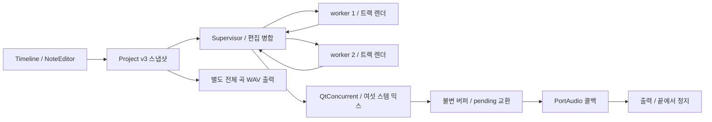

# FERRO의 프로젝트·렌더링·재생 구조

FERRO는 사용자가 타임라인에 배치한 곡 전체를 미리 렌더하고, PortAudio 콜백이 완성된 불변 버퍼를 읽어 재생합니다. 기본 재생은 한 번 끝까지 진행한 뒤 멈춥니다. 합성·샘플 디코딩·파일 입출력·프로세스 제어는 콜백 밖에서 수행합니다.



## 프로젝트 v3

[project.h](../src/project.h)와 [project.cpp](../src/project.cpp)가 직렬화·검증·이벤트 스케줄링을 맡습니다.

| 구성 | 저장하는 정보 |
| --- | --- |
| Project | 제목, BPM, songBars, tailSeconds, 마스터·딜레이·duck·메트로놈, 여섯 트랙 |
| Track | 이름, instrument, 음색·레벨·팬, mute/solo, 샘플 경로, 프레이즈 목록, 클립 목록 |
| Pattern | 프레이즈 이름, 1–16마디 길이, 마디 수 × 16개의 Step |
| Step | 같은 시점에 울릴 여러 음. 각 음은 velocity 0–1과 MIDI note 0–127을 가지며 저장된 음높이는 velocity 0인 음을 포함해 중복되지 않음 |
| Clip | 곡 전체에서 유일한 ID, 해당 트랙의 프레이즈 인덱스, 시작 마디, 재생 마디 수 |

프레이즈는 트랙마다 최대 128개, 클립은 최대 256개입니다. 같은 트랙의 클립은 겹칠 수 없습니다. 서로 다른 트랙은 같은 시간에 재생할 수 있습니다. 클립은 참조한 프레이즈를 자신의 길이만큼 반복하며 마지막 반복은 클립 끝에서 잘립니다. 잘리는 대상은 새 음의 시작이며 이미 발생한 소리의 꼬리는 렌더 끝까지 남을 수 있습니다.

곡 길이는 1–256마디, 템포는 40–300 BPM, 출력 꼬리는 0–8초입니다. 곡과 꼬리의 총길이는 600초 이하입니다. UI는 현재 템포와 꼬리를 고려한 최대 마디 수를 적용하고, 불러오기·저장·렌더의 수치 검증도 수행합니다. 비정상 수, 정수가 필요한 자리에 온 소수, 잘못된 프레이즈 참조, 중복 ID, 겹친 클립, 곡 밖의 클립은 거절합니다. 파일 입력 크기는 16 MiB로 제한합니다.

`songFrames()`는 마지막 마디 경계까지, `renderFrames()`는 거기에 tailSeconds를 더한 프레임 수를 반환합니다. 기존 내부 이름인 `loopFrames()`는 renderFrames의 별칭이며 곡의 무조건 반복을 뜻하지 않습니다.

`scheduledSteps()`는 각 클립의 반복을 절대 곡 위치로 펼칩니다. 한 스텝에 화음이 있으면 구성음마다 같은 시작 프레임의 이벤트를 만들고 각 음의 세기를 유지합니다. 이벤트의 프레임은 다음 식으로 매번 전체 위치에서 계산합니다.

```text
frame = llround(absoluteSixteenth * 60 * 48000 / (BPM * 4))
```

스텝 길이의 정수 반올림값을 계속 더하지 않으므로 소수 BPM에서도 누적 오차가 생기지 않습니다. 이벤트는 시간순으로 정렬됩니다. 결정적인 이벤트 ID에는 트랙·클립 ID·클립 내 시작 위치가 반영되므로 다른 트랙을 편집해도 기존 잡음 음색의 시드가 바뀌지 않습니다.

구버전 v1을 열면 각 트랙의 네 패턴을 프레이즈로 보존하고 공유 arrangement를 트랙별 클립으로 변환합니다. 연속해서 같은 패턴을 사용하던 마디는 반복 클립으로 묶습니다. 제목·음·트랙 설정·샘플 경로를 보존하고 악기 종류는 기존 트랙 번호에서 복원합니다. 꼬리는 2초로 설정합니다. v2의 클립 배치와 단음 스텝도 그대로 읽을 수 있습니다. 읽기 실패 시 기존 Project를 교체하지 않습니다. 다시 저장할 때 각 스텝의 여러 음을 담는 v3 JSON을 사용하며 `QSaveFile`로 완성한 파일만 교체합니다. 샘플은 파일에 포함하지 않고 상대 경로로 기록합니다.

## 타임라인과 음 입력

[timeline.cpp](../src/timeline.cpp)의 Timeline은 클립 생성·이동·복제·반복 길이 조절·독립 복사를 담당합니다. 같은 트랙에서 Ctrl 드래그와 복제는 원본 프레이즈를 공유합니다. `Make independent`는 선택한 클립을 새 프레이즈 사본에 연결합니다. 다른 트랙으로 이동할 때도 프레이즈를 복사하므로 대상 트랙의 악기와 독립적으로 편집할 수 있습니다. 음 입력용 NoteEditor는 16분음표 칸마다 여러 음을 저장하고 24음 범위의 피아노 롤을 표시합니다. 음표 길이는 별도로 저장하지 않으며 악기·DECAY·샘플 길이가 소리의 지속에 영향을 줍니다.

일반 왼쪽 클릭은 해당 시간·음높이에 활성 음이 없으면 추가하거나 다시 활성화하고, 있으면 그 음만 삭제합니다. 왼쪽 드래그는 누른 위치가 비어 있으면 그리기, 활성 음이면 지우기로 시작해 버튼을 놓을 때까지 같은 모드를 유지합니다. 따라서 같은 칸을 다시 지나가도 추가·삭제가 번갈아 일어나지 않습니다. 오른쪽 클릭·드래그도 닿은 음만 삭제합니다. Shift + 왼쪽 클릭은 기존 음만 선택하며 음을 만들거나 무음의 음을 활성화하지 않습니다.

`PITCH`와 `VELOCITY`는 선택한 음에만 적용되며 같은 스텝의 다른 활성 음과 겹치는 음높이 변경은 거절합니다. 대상 음높이에 velocity 0인 음만 있으면 그 무음의 음을 제거하고 선택한 음을 옮깁니다. 따라서 저장된 음높이의 유일성을 유지하면서 화음 안의 개별 음을 수정할 수 있습니다.

[window.cpp](../src/window.cpp)는 편집을 짧은 단발 타이머로 합쳐 렌더 스냅샷을 제출합니다. 연속 수정은 대기 중인 예전 요청을 최신 상태로 대체합니다. 이전 요청이 나중에 끝나도 요청 번호와 현재 프로젝트를 비교해 오래된 오디오가 게시되지 않도록 합니다. 프로젝트 데이터는 오디오 콜백에서 직접 읽지 않습니다.

새 곡·파일 열기·복구에서는 기존 오디오를 무효화합니다. 실행 취소와 다시 실행은 프로젝트 스냅샷을 복원합니다. 수정한 세션의 자동 저장은 30초 간격이며 복구본을 열면 저장 전 수정 상태를 유지합니다. GUI는 `QLockFile`로 사용자당 한 인스턴스를 유지합니다.

## Supervisor와 워커 생명주기

[supervisor.cpp](../src/supervisor.cpp)는 기본 두 개의 장기 실행 `QProcess`를 사용합니다. 각 자식은 동일 실행 파일의 `--worker` 모드이며 한 번에 한 트랙을 렌더합니다. stdin/stdout은 줄 단위 JSON 프로토콜, stderr는 진단입니다.

```json
{"id":17,"project":{"format":"ferro-project","version":3},"track":0,"path":"/private-temp/3-17.f32"}
```

위 project는 형식 설명을 위한 축약이며 실제로는 전체 프로젝트를 전송합니다. 워커는 곡과 꼬리를 포함한 스테레오 스템을 임시 파일에 쓰고 원자적으로 교체한 뒤 응답합니다. 데이터는 헤더 없는 인터리브 little-endian float32입니다.

```json
{"id":17,"ok":true,"path":"/private-temp/3-17.f32","frames":1632000,"error":""}
```

부모는 ID·경로·프레임 수·정확한 바이트 수와 모든 샘플의 유한성을 확인합니다. 검증한 결과만 메모리에 옮기고 임시 파일을 지웁니다. 최신 배치의 여섯 스템이 준비되면 `QtConcurrent::run`으로 마스터 믹스를 수행하며, 믹스 완료 시에도 최신 요청인지 확인합니다.

워커는 기본 32개 작업 뒤 재활용합니다. graceful reload는 새 세대를 생성하고 이전 세대를 draining 상태로 전환합니다. 이전 세대는 새 작업을 받지 않고 현재 작업을 완료한 뒤 stdin EOF로 종료합니다. 연속 reload는 합쳐 처리합니다. 실행 중인 코드에 패치를 끼워 넣는 방식이 아니라 새 프로세스로 교체하는 방식입니다.

충돌·프로토콜 오류·잘못된 출력 파일·작업 시간 초과는 워커 교체와 제한된 재시도를 유발합니다. 트랙당 시도 횟수와 연속 오류 예산을 제한해 끝없는 재시작을 막습니다. 유효한 요청의 샘플 누락·계산 한도 오류는 배치 실패로 알려 정상 프로세스를 유지합니다. 종료 시 EOF, 유예, terminate, 필요하면 kill/wait 순서로 자식을 회수합니다.

현재 기본 작업 제한 시간은 트랙당 60초입니다. 길이가 허용 범위 안에 있어도 CPU·샘플 배치에 따라 시간 제한을 넘을 수 있습니다. 최대 곡 길이는 모든 환경에서의 실시간 렌더 성능 보증이 아닙니다.

## DSP와 끝부분 처리

[dsp.cpp](../src/dsp.cpp)는 트랙 번호 대신 `instrument`에 따라 Kick·Bass·Saw·Lead·Clap·Hats를 합성합니다. 킥은 피치 엔벌로프와 포화 파형을 오버샘플링하고, 베이스·신스는 polyBLEP 파형과 필터를 사용합니다. 클랩과 하이햇에는 결정적인 잡음을 사용합니다. 같은 프로젝트를 반복 렌더하면 같은 결과를 얻습니다.

소리와 딜레이의 꼬리는 곡 끝에서 처음으로 감지 않습니다. 음은 클립의 시간에 시작하고 이후 에너지는 출력 꼬리 공간으로 이어집니다. Saw·Lead·Clap 악기는 유한한 딜레이 탭으로 보내며 메트로놈은 명시적인 곡 마디 안에만 발생합니다. Bass duck은 실제로 재생 대상인 Kick 악기의 이벤트를 따릅니다. 킥이 mute되거나 solo 대상에서 빠지면 그 킥의 duck도 제외합니다.

최종 믹스는 mute/solo, 딜레이, 메트로놈, DC 제거, 마스터 게인, 출력 제한을 적용합니다. WAV 출력은 별도 작업에서 프로젝트 스냅샷의 처음부터 끝까지 한 번 렌더합니다. 재생 위치·Loop 설정·워커 reload는 내보내는 곡의 범위를 바꾸지 않습니다. 파일은 48 kHz 스테레오 24비트 PCM이며 효과음 꼬리를 포함합니다.

샘플은 libsndfile로 읽으며 최대 16초, 8–384 kHz, 1–8채널을 허용합니다. MIDI 60이 원래 속도이며 sinc 리샘플링으로 음높이를 바꿉니다. 저음 변환은 길이도 늘립니다. 음 하나의 길이·피치 캐시 메모리·전체 이벤트의 믹싱 길이·서로 다른 피치의 변환량에 계산 한도를 둡니다. 과도한 배치는 실제 합성 전에 안내 오류로 반환합니다.

GUI에서 샘플을 가져올 때 트랙의 모든 스텝이 단음이면 기존 동작대로 저장된 음높이를 MIDI 60으로 맞춥니다. 어느 프레이즈에든 같은 스텝의 활성 음이 둘 이상이면 트랙 전체의 기존 음높이를 유지합니다. 샘플의 실제 근음을 분석하지는 않으며 유지된 음높이도 MIDI 60 기준으로 재생합니다.

## 오디오 콜백과 자원 한계

[audio.cpp](../src/audio.cpp)는 네 개의 버퍼 슬롯을 사용합니다. 제어 스레드는 빈 슬롯의 메모리를 채운 뒤 atomic pending 교환으로 게시합니다. 콜백은 완성된 샘플만 읽습니다. 슬롯은 `Free → Building → Owned → Retired → Free`로 이동하고 실제 벡터 해제는 제어 스레드의 collect에서 수행합니다. 사용하는 atomic 타입의 lock-free 조건을 컴파일 시 검사합니다.

재생 중 버퍼 교체는 마디 경계에서 이루어지고 짧은 crossfade를 적용합니다. 정지 상태에서는 다음 콜백에 새 버퍼를 반영합니다. 재생·정지·탐색에는 짧은 보간을 적용합니다. 탐색 요청은 절대 프레임 위치이며 콜백이 유효 범위로 제한합니다. Loop 기본값은 false이고 끝에서는 transport를 정지시켜 커서를 유지합니다. Loop를 명시적으로 켰을 때만 전체 재생 버퍼를 반복합니다.

장치에는 48 kHz float32 스테레오, 256프레임 블록을 요청합니다. 콜백은 프로세스 IPC·파일 입출력·메모리 할당과 해제를 수행하지 않습니다. 장치와 서버의 추가 버퍼 때문에 실제 지연은 설정에 따라 달라집니다. 화면의 CPU는 콜백 처리 부하이며 합성 작업의 전체 CPU가 아닙니다.

전체 곡과 여섯 스템, 진행 중인 믹스와 게시 버퍼는 곡 길이에 비례한 메모리를 사용합니다. 10분짜리 스테레오 float32 버퍼 하나만 약 230 MB이며 여러 버퍼가 존재할 수 있습니다. 긴 곡의 편집 반영은 합성 완료를 기다립니다. 현재 구현은 디스크 기반 긴 오디오 스트리밍·녹음·플러그인 호스팅·파라미터 자동화를 제공하지 않습니다.

검증 명령과 실제 수행 결과는 [VERIFICATION.md](VERIFICATION.md)에 기록합니다.

클립 삭제는 저장된 원본 프레이즈를 제거하지 않습니다. 미배치 원본은 빈 타임라인의 Insert phrase 메뉴에서 재사용할 수 있습니다. 오디오 submit은 버퍼별 revision을 반환하고 콜백이 취득한 revision을 별도로 게시합니다. UI는 렌더 변경 중의 탐색을 마디 단위로 보관한 뒤, 일치하는 버퍼의 취득이 확인되면 그 버퍼의 BPM으로 프레임을 계산합니다. 따라서 길이·템포 변경 도중에도 이전 버퍼 길이에 의해 목표가 잘리거나 화면 재생 위치가 고정되지 않습니다. 마스터는 마지막 128프레임을 0으로 페이드해 지정한 곡 끝에서 파형이 끊어질 때의 불연속을 줄입니다. 믹스 완료 뒤에는 작업 배치의 중간 스템들을 회수합니다.
